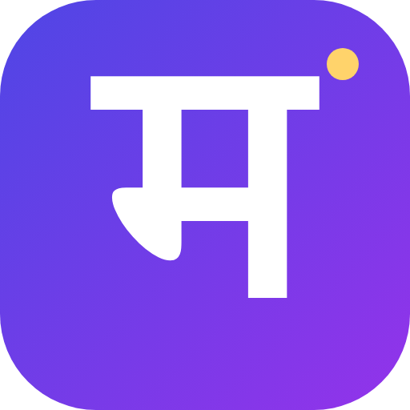

# Mnemo logo

The Devanagari letter "म" (the M of Mnemo) in white on an indigo-to-violet tile (`#4F46E5` to
`#9333EA`), with a small gold dot (`#FFD36B`). It replaces OpenMuse's capybara mascot in the app,
the app icon and the browser favicon.

| File | Use |
|---|---|
| `apps/mobile/assets/mnemo-logo.png` (256 px) | In-app logo (`Mascot` in `apps/mobile/src/ui.tsx`) |
| `apps/mobile/assets/icon.png` (1024 px) | App icon (`expo.icon`) |
| `apps/mobile/assets/favicon.png` (48 px) | Browser tab icon (`expo.web.favicon`) |
| `docs/brand/mnemo-logo.png` (512 px) | README and docs |

To change the logo, edit [`render-logo.mjs`](render-logo.mjs) and run it. It renders with the
"Nirmala UI" font that ships with Windows.
